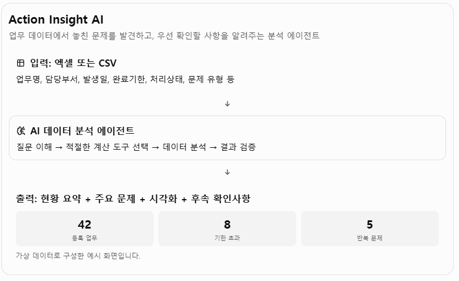
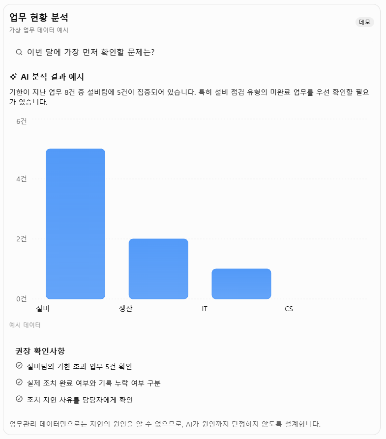
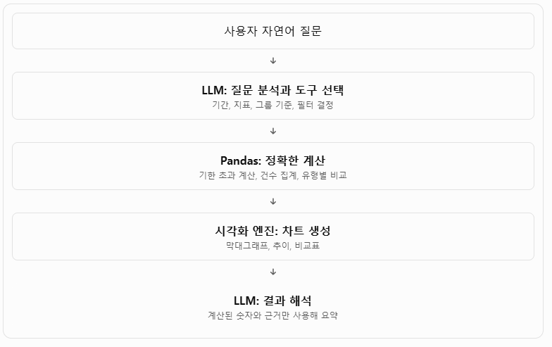

# 초기 기획안과 결과물 비교

> 프로젝트 시작 시점에 팀장(AI 에이전트 담당)이 정리한 **초기 기획안**(역할 배분·목표·일정·업무 분류)과, 개발 마감 시점(2026-11-25, main 기준)의 **실제 결과물**을 나란히 놓고 무엇이 그대로 유지되고 무엇이 왜 바뀌었는지 정리한 발표 준비 문서입니다.
> 킥오프 공지는 [`plan_day1.md`](plan_day1.md), 확정된 설계 기준은 [`CLAUDE.md`](../CLAUDE.md)입니다. 이 문서와 다르면 `CLAUDE.md`를 따릅니다.
> 그림 3장은 기획 단계에서 만든 **설명용 목업**입니다. 그림 속 숫자(42건, 8건, 설비팀 5건 등)는 가상 예시이며 실제 앱의 계산 결과가 아닙니다.

## 목차
- [Part 1. 초기 기획안](#part-1-초기-기획안)
- [Part 2. 계획 대비 결과](#part-2-계획-대비-결과)
- [Part 3. Discussion](#part-3-discussion)

---

## Part 1. 초기 기획안

### 1. 제안한 프로젝트의 모습



*초기 구상 목업. 이름 "Action Insight AI"는 기획 단계의 가칭이며, 최종 프로젝트명은 Task Insight입니다.*

핵심은 사용자가 복잡한 그래프를 일일이 해석할 필요가 없도록 **AI가 중요한 변화와 그 근거를 먼저 제시하는 것**입니다.

예를 들어 안전관리자는 "어느 구역에서 개선조치가 반복적으로 지연되는가?"를, 품질관리자는 "어느 공정의 불량 개선조치가 오래 걸리는가?"를, 시설관리자는 "어떤 설비의 수리가 반복되는가?"를 물을 수 있습니다. 같은 분석 엔진을 사용하고, 데이터만 바뀝니다.

### 2. 실제로 어떤 데이터를 넣어야 하나?

중요한 것은 **업무 내용을 표준화하는 것이 아니라, 업무 관리에 필요한 공통 항목만 정의하는 것**입니다.

| ID | 분야 | 업무 및 문제 | 담당부서 | 등록일 | 기한 | 상태 |
| --- | --- | --- | --- | --- | --- | --- |
| 001 | 안전 | 프레스 방호덮개 이상 | 설비팀 | 11/02 | 11/09 | 진행 중 |
| 002 | 품질 | 포장 불량 개선 | 생산팀 | 11/05 | 11/12 | 완료 |
| 003 | 시설 | 냉난방기 누수 | 시설팀 | 11/07 | 11/14 | 진행 중 |
| 004 | IT | 사내 PC 장애 | IT팀 | 11/10 | 11/11 | 완료 |
| 005 | 고객지원 | 반복 접수된 배송 불만 | CS팀 | 11/11 | 11/16 | 진행 중 |

*설명용 가상 데이터입니다. 실제 구현에서는 발생일과 완료일, 업무 유형 및 반복 문제 식별 정보도 정의하는 것이 좋습니다.*

이러한 자료로 계산하려던 것:
- 기한이 지난 미완료 업무는 몇 건인가?
- 담당부서별 처리율에 차이가 있는가?
- 어느 유형의 문제가 반복되는가?
- 처리기간이 늘어나고 있는가?
- 어떤 업무에 대한 추가 확인이 필요한가?

'우선 확인'은 기한 초과, 반복 발생, 사용자 지정 중요도 등의 근거로 제시해야 하며, **AI가 문제의 위험도를 자의적으로 확정하는 것은 피한다**는 원칙을 세웠습니다.

### 3. 시각화 구성

차트를 나열하기보다 **하나의 핵심 질문에서 시작하는 방식**을 택했습니다.



*초기 데모 목업 (가상 데이터). "업무관리 데이터만으로는 지연의 원인을 알 수 없으므로, AI가 원인까지 단정하지 않도록 설계"한다는 문구가 이 단계부터 들어가 있습니다.*

이 정도만 구현해도 **엑셀 데이터를 올리고 → AI에게 질문하고 → 분석 결과를 그래프와 설명으로 확인하는 완성된 사용 흐름**이 만들어집니다.

### 4. AI 에이전트가 해야 할 일

데이터를 LLM에 통째로 전달하고 "분석해 줘"라고 요청하는 방식은 피합니다.
**LLM은 분석할 방법을 결정하고, Python이 계산하며, LLM이 결과를 설명하는 구조**를 제안했습니다.



처음부터 여러 AI 에이전트를 만들기보다 **단일 LLM + 4~5개 분석 도구 + 명시적인 검증 로직**으로 시작합니다.
예: `count_overdue_tasks`, `summarize_by_category`, `calculate_completion_rate`, `compare_periods`, `find_recurring_issues`

### 5. 역할 배분

| 역할 | 주요 개발 내용 | GitHub |
| --- | --- | --- |
| **AI 에이전트** (팀장) | 질문 해석, 도구 선택, AI 출력 검증 | docie-rgb |
| 데이터 엔지니어링 | CSV 업로드, 전처리, 분석 함수 개발 | zslayer-dev |
| 프론트엔드 및 시각화 | Streamlit 화면, Plotly 그래프, 질문 입력 UI | jhwksh |
| 통합 및 보고서 | 결과 연결, 보고서 생성, 테스트, 배포 | victorymankang-dot |

*공개 저장소이므로 실명 대신 역할과 GitHub 계정으로 적었습니다.*

단순한 병렬 개발보다 **인터페이스를 첫날 합의하는 것**을 중요하게 보았습니다. 예를 들어 AI가 반환하는 결과 형식을 다음과 같이 고정하는 방식입니다.

```json
{
  "metric": "overdue_count",
  "group_by": "department",
  "period": "2026-11",
  "chart_type": "bar",
  "summary": "기한 초과 업무가 많은 부서를 비교합니다."
}
```

`summary`는 분석 전의 설명이고, 실제 수치와 결론은 데이터 계산 이후에 생성해야 합니다.

### 6. 일주일 개발 일정

| 일차 | 목표 |
|---|---|
| 1 | 기획 확정: 고객, 데이터 구조, 질문 5개, 함수와 응답 형식 정의 |
| 2 | 데이터 처리: CSV 입력, 필수 컬럼 검사, 통계 함수 구현 |
| 3 | AI 에이전트: 자연어 질문을 분석 함수 호출로 변환 |
| 4 | UI 및 시각화: 핵심 지표 카드, 그래프, 원본 데이터 확인 기능 |
| 5 | 통합: 질문부터 분석 결과 출력까지 연결 |
| 6 | 검증: 사전 정답을 정한 질문 10~20개로 계산 정확도 및 도구 선택 검증 |
| 7 | 배포 및 발표: 공개용 가상 데이터 사용, 실제 동작 시연 |

추가로 기존 엑셀 피벗테이블이나 미리 구성한 대시보드와 비교해, **사용자가 원하는 정보를 얻는 단계 수와 정확성**을 평가하면 결과가 더 설득력 있어진다고 보았습니다.

### 7. 각자에게 남는 기술적 자산

| 해커톤 개발 결과 | 업무 활용 |
| --- | --- |
| CSV/DB 분석 파이프라인 | 안전점검, TBM, 개선조치 데이터 |
| 자연어 질문의 구조화 | EHS 관리자의 자연어 데이터 조회 |
| 계산 도구 호출 | 개선조치 기한, 위험유형별 집계 |
| 데이터 근거 검증 | AI의 숫자 생성 및 사실 왜곡 방지 |
| 대시보드 시각화 | 사업장 현황, 보고서, PDCA 성과 |
| 보고서 생성 | 안전보건 월간 실적보고 |

핵심 기술은 **자연어 질의를 검증 가능한 데이터 조회와 계산으로 바꾸는 에이전트 구조**입니다.

### 8. 최종 제안 (당시)

- **주제:** AI 기반 업무 현황 진단 및 개선 우선순위 분석 에이전트
- **핵심 고객:** 데이터를 기반으로 업무 현황을 관리하는 실무자와 관리자
- **입력:** 업무 관리 CSV/엑셀 + 자연어 질문
- **출력:** 현황 요약, 문제 및 지연 분석, 그래프, 근거와 후속 확인사항
- **개발 범위:** 5개 내외 분석 도구, 공통 데이터 구조 1개, 검증 가능한 질문 10~20개
- **단서:** "어떤 엑셀 파일이든 AI가 알아서 분석한다"는 약속은 하지 않는다. 지원하는 컬럼과 지표를 명확히 정해야 완성도와 신뢰성을 확보할 수 있다.

---

## Part 2. 계획 대비 결과

### 한눈에 보기

| 항목 | 초기 계획 | 결과 (2026-11-25 main) | 판정 |
|---|---|---|---|
| 기본 구조 | 단일 LLM + 계산 도구 + 검증 로직 | 그대로. Gemini function calling 1개가 도구와 인자만 고르고, 계산은 `engine.run_tool`만 | 유지 |
| 분석 도구 | 4~5개 | 엔진 도구 10개 (`aggregate`, `calculate_ratio`, `compare_periods`, `count_overdue_tasks`, `summarize_by_category`, `calculate_completion_rate`, `find_recurring_issues`, `mh_overrun`, `cost_vs_budget`, `check_missing_data`) + 에이전트 전용 2개 (`ask_clarification` 되묻기, `note_limitation` 지원 불가 안내) | 확장 |
| 에이전트 흐름 | 질문 → LLM 계획 → 계산 → 차트 → LLM 설명 | 질문 → **사전 차단** → LLM 계획 → **사후 검증·1회 재계획** → **사용자 승인(계획 지문 SHA-256)** → 실행 → 표·차트·근거 | 강화 |
| 결과 설명 | LLM이 계산된 숫자로 해석 | **Python 템플릿**(`agent/explain.py`, LLM 미사용). 숫자는 모두 `ToolResult`에서 가져옴 | 변경 |
| 인터페이스 계약 | `metric`·`group_by`·`period`·`chart_type`·`summary` JSON 1개 | `contracts.py`의 `AnalysisPlan`(독립 단계 최대 4개: `tool`·`params`·`purpose`·`chart_type`), `ToolResult`(`rows`·`basis`·`unit`·`error`) | 구체화 |
| 데이터 | 업무관리 CSV 1종, 공통 항목 정의 | kafe 가상 제조기업 다중 CSV(업무·직원·프로젝트 결합) + 과제 `sample.csv` + 일반 CSV(재고·영업·품질, 카페 매출, 학습 기록 등) | 확장 |
| "아무 엑셀이나" | 약속하지 않는다 | 지키는 중. 데이터에 없는 개념·지원하지 않는 계산은 LLM 호출 전에 "지원 불가" 또는 되묻기. 컬럼 의미 해석(#44)은 기능 스위치 `TI_COLUMN_HINTS` **기본 OFF** | 유지 |
| 우선 확인 근거 | 기한 초과·반복 발생·지정 중요도 | 기한 초과·반복 이슈·빠진 정보·공수/비용 초과를 도구로 계산. 위험도·원인은 단정하지 않음 | 유지 |
| 시각화 | 핵심 지표 카드, 그래프, 원본 데이터 확인 | 한 줄 결과 = 숫자 카드, 월·날짜 = 선, 그 밖 = 막대. 차트와 표는 같은 `rows`로 그림. 결과 옆에 기준·단위 표시 | 달성 |
| 검증 | 사전 정답 질문 10~20개 | 엔진 정답 테스트 + 에이전트 채점 `eval/` 6개 묶음 약 97문항(kafe 7, sample 5, extra 22, general 21, holdout 17, schema 25), 반복 측정 `--repeat`, 한도 초과는 오답에서 제외. pytest 565 통과 | 초과 달성 |
| 엑셀 대비 비교 | 단계 수·정확성 비교 | 정답표(`docs/answer_key.md`)에 질문별 엑셀 풀이(피벗·XLOOKUP 등)를 기록. 단계 수의 정량 비교는 미수행 | 일부 |
| 배포 | 공개용 가상 데이터로 시연 | Streamlit Community Cloud 배포 + 발표용 정적 홈페이지(`ui/homepage`, 앱을 iframe으로 포함) | 달성 |
| 역할 | 4개 역할 분담 | 폴더 단위 담당으로 정착 (`engine/`·`agent/`·`ui/`+`app.py`·`tests/`+`docs/`). `contracts.py`는 전원 합의 후에만 수정 | 유지 |

### 구조도: 계획 vs 결과

```
[초기 계획]                              [결과]
사용자 질문                               사용자 질문 + CSV
   │                                        │
   ▼                                        ▼
LLM: 질문 분석·도구 선택                 사전 차단 (LLM 호출 없음)
   │                                      - 데이터에 없는 개념·용어 → 지원 불가
   ▼                                      - 대상이 모호 → 되묻기
Pandas: 정확한 계산                         │
   │                                        ▼
   ▼                                     LLM: 도구·인자 선택 (Gemini function calling)
시각화 엔진: 차트                            │
   │                                        ▼
   ▼                                     사후 검증 (코드)
LLM: 결과 해석                             - 허용 도구·인자 스키마, 질문 조건 반영 여부,
                                            계산 의도(곱셈·비율) 일치 → 어긋나면 1회 재계획
                                            │
                                            ▼
                                         사용자 승인 (계획 지문 고정, 바뀌면 재승인)
                                            │
                                            ▼
                                         engine.run_tool: pandas 계산 → ToolResult
                                            │
                                            ▼
                                         표·차트(같은 rows) + Python 템플릿 설명 + 기준·단위
```

---

## Part 3. Discussion

### 1. 결과 해석에서 LLM을 뺐다
초기 구조도의 마지막 단계는 "LLM: 결과 해석 (계산된 숫자와 근거만 사용해 요약)"이었습니다. 실제로는 **설명문을 Python 템플릿으로 만들고 LLM을 쓰지 않았습니다.**
- **이유:** "계산된 숫자만 사용하라"는 지시는 프롬프트로는 보장되지 않습니다. 템플릿은 `ToolResult`의 값만 쓸 수 있으므로 숫자 생성·왜곡이 구조적으로 불가능합니다. 원인·예측을 쓰지 않는다는 원칙(목업의 "원인까지 단정하지 않도록")도 코드로 강제됩니다.
- **대가:** 설명이 자연스럽지 않고, 여러 결과를 엮어 해석하는 문장은 만들지 못합니다.
- **남은 선택지:** LLM이 문장을 다듬되 숫자는 자리표시자로 두고 코드가 채우는 방식은 발표 이후 과제로 남깁니다.

### 2. "승인" 단계가 추가됐다
초기 계획에는 사용자가 계획을 확인하는 단계가 없었습니다. 개발 중 Gemini가 질문의 조건(부서·기간·지표)을 빠뜨리거나 비슷한 다른 지표를 고르는 일이 반복되면서 **계획 → 승인 → 실행**으로 바꿨습니다.
- 사용자가 계산식(예: `SUM(현재수량 × 단가)`, `불량수량 합계 ÷ 생산수량 합계 × 100`)을 실행 전에 볼 수 있습니다.
- 승인 후 인자가 하나라도 바뀌면 실행하지 않습니다(계획 지문 SHA-256).
- 대가는 클릭 한 번이 늘어난 것과 Gemini 호출 지연입니다.

### 3. 검증 로직이 계획보다 훨씬 커졌다
"명시적인 검증 로직"은 초기 계획에 있었지만 규모는 예상보다 컸습니다. LLM 앞(사전 차단)과 뒤(사후 검증) 양쪽에 검사가 들어갔습니다.
- **사전 차단:** 데이터에 없는 정보를 묻는 질문은 LLM이 "비슷한 다른 분석"으로 대신 답하는 경향이 있어, 호출 전에 막습니다. 무료 호출 한도도 아낍니다.
- **사후 검증:** 질문의 조건·계산 의도가 계획에 반영됐는지 코드가 확인하고, 어긋나면 1번 재계획, 그래도 안 되면 지원 불가로 안내합니다.
- **긴장 관계:** 사전 차단이 엄격할수록 "범용 에이전트로는 너무 빡빡하다"는 의견이 나왔습니다(예: 질문의 '고객'과 데이터의 `buyer` 컬럼). 이를 위해 컬럼 의미 해석(#44)을 만들었으나, 실제 Gemini 시험에서 판단이 애매한 경우(예: `agency`)가 남아 **기본 OFF로 두고 발표에서는 켜지 않기로** 했습니다. 정확도와 범용성 사이에서 정확도를 먼저 택한 결정입니다.

### 4. 범위는 넓어졌지만 약속은 그대로다
- 초기에는 "업무관리 CSV 1종 + 공통 항목"이었으나, 결과물은 다중 CSV 결합(kafe)과 구조가 다른 일반 CSV까지 분석합니다.
- 그래도 "어떤 엑셀이든 알아서 분석한다"는 약속은 하지 않았습니다. 지원하지 않는 질문은 숫자 없이 "지원 불가"로 끝나며, 다른 분석으로 바꿔 답하지 않습니다.
- 처음 우려한 "일주일 안에 신뢰성 확보"는 범위를 좁혀서가 아니라 **답하지 않을 때를 명확히 정해서** 확보했습니다.

### 5. 인터페이스 첫날 합의는 효과가 있었다
초기 JSON 계약(`metric`/`group_by`/…)은 한 질문에 한 지표만 담을 수 있어 그대로 쓰이지 않았지만, "형식을 먼저 고정한다"는 원칙은 `contracts.py`로 이어졌습니다. 4명이 각자 폴더에서 병렬로 PR을 올리고 squash merge로 합칠 수 있었던 기반입니다. 다만 엔진 도구가 늘어날 때마다(#38·#40) 에이전트가 따라가는 연동 PR(#39·#42)이 필요했습니다.

### 6. 검증은 계획의 5배 규모가 됐다
질문 10~20개 계획 대비 약 97문항, 6개 묶음으로 늘었습니다. 특히 다음은 계획에 없던 것입니다.
- **holdout:** 개발 중 보지 않은 질문으로 과적합 확인
- **반복 측정:** 같은 질문에도 Gemini 계획이 흔들려 1회 측정이 ±1~2문제 달라지는 것을 확인하고 `--repeat`로 범위를 봄
- **한도 초과(429) 처리:** 무료 키 한도 때문에 생긴 실패를 오답으로 세지 않음

### 7. 하지 못한 것
- **엑셀 대비 단계 수 정량 비교:** 정답표에 엑셀 풀이 방법은 적었으나, "몇 단계 만에 같은 답에 도달하는가"를 측정·비교하지는 못했습니다.
- **능동적 리스크 브리핑:** 파일을 올리자마자 문제를 먼저 찾아 주는 기능(목업의 42/8/5 카드)은 질문 기반 흐름에 집중하느라 구현하지 않았습니다.
- **결과 간 연결 질문:** 앞 결과에 따라 다음 계산의 인자가 바뀌는 질문(예: "가장 지연이 많은 부서의 담당자별 현황")은 지원하지 않습니다.
- **스키마 매핑:** 질문 용어와 컬럼 이름을 사용자가 확인하는 매핑 기능은 발표 이후 설계 과제로 남겼습니다.

### 8. 남는 자산 (초기 7절 대비)
초기 기획에서 꼽은 핵심 자산인 **"자연어 질의를 검증 가능한 데이터 조회와 계산으로 바꾸는 에이전트 구조"**는 계획보다 구체적인 형태로 남았습니다: 허용 목록 도구, 사전 차단과 사후 검증, 승인 지문, LLM 없는 설명, 반복 측정 가능한 채점 묶음.
